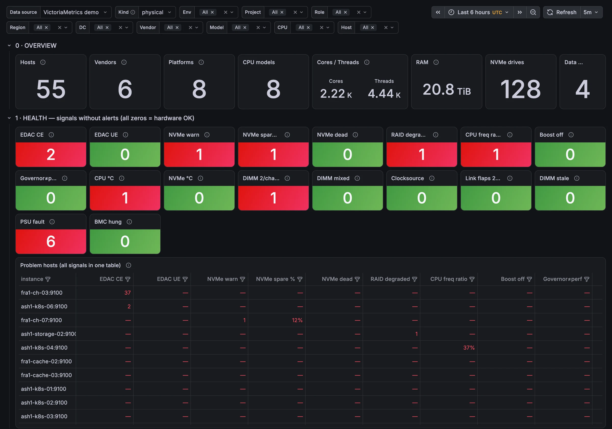
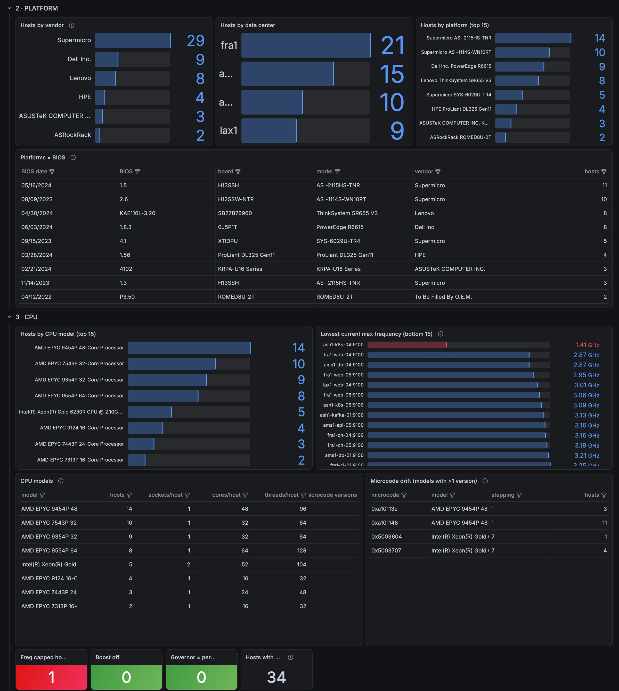
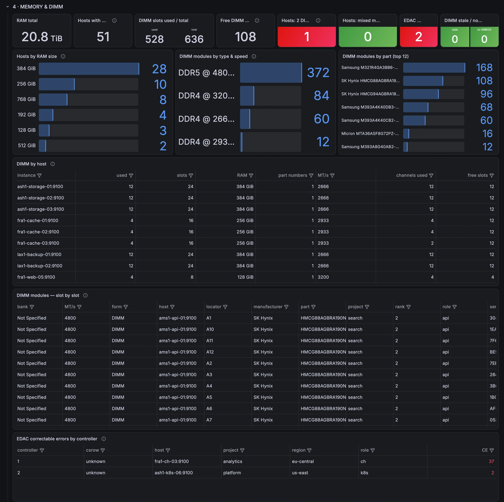
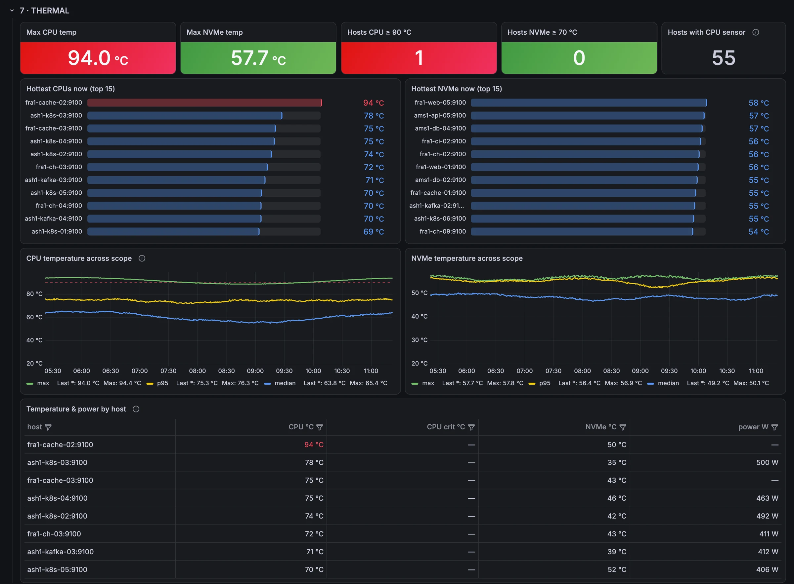
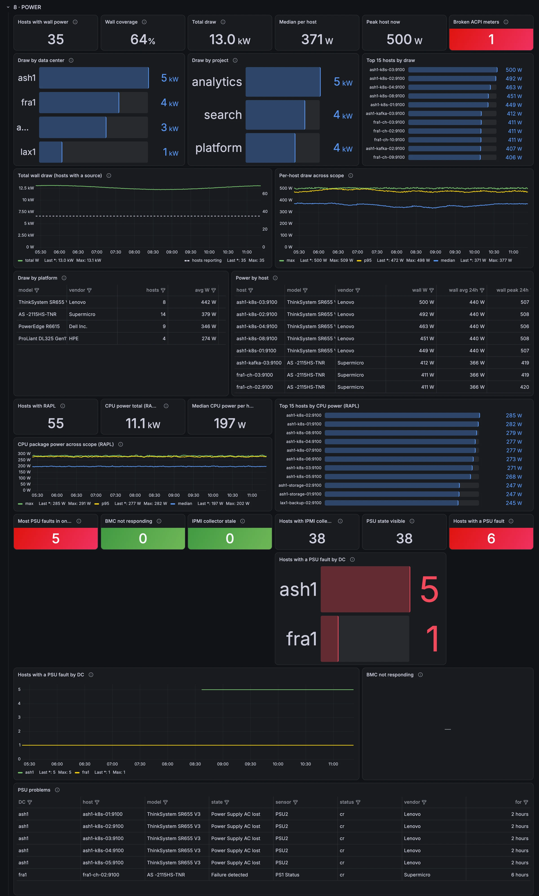
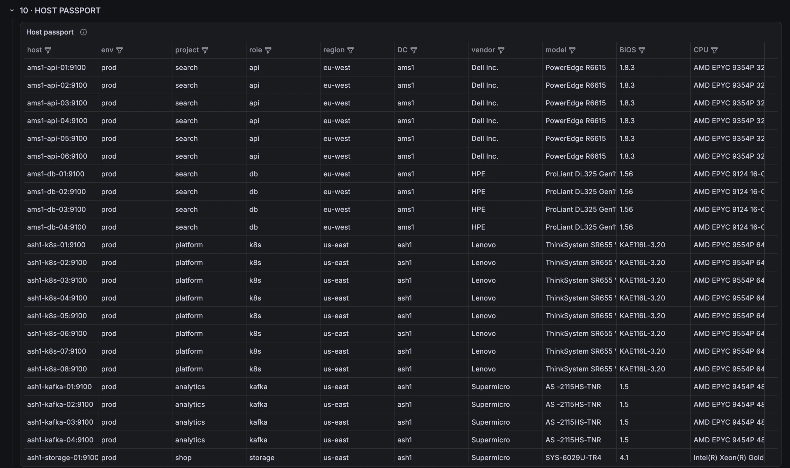

# Fleet Hardware Inventory

A Grafana dashboard that turns plain node_exporter metrics into a hardware inventory and health view
for a fleet of servers. It answers questions like *which hosts run old BIOS*, *where can I add RAM
without replacing modules*, *which boxes are stuck at a low CPU clock*, *what does a rack of this
model draw from the wall* and *which hosts have a degraded array, a dying NVMe or a lost PSU*.

Built for a large mixed fleet of bare-metal hosts (Supermicro, ASRockRack, Dell, HPE, Lenovo, ASUS)
and cloud VMs. It works just as well on a handful of machines.



## What's inside

| Row | What you get |
| --- | --- |
| 0 · Overview | Hosts, vendors, platforms, CPU models, cores/threads, RAM, NVMe drives, data centers |
| 1 · Health | Signals that usually have no alerts: EDAC errors, NVMe warnings / spare / dead controllers, degraded RAID, capped CPU clocks, boost off, wrong governor, hot CPUs and NVMe, DIMMs stacked on few channels, mixed modules, non-tsc clocksource, link flaps, PSU faults, hung BMCs, plus one table with every problem host |
| 2 · Platform | Hosts by vendor, DC and platform; platform × BIOS version |
| 3 · CPU | CPU models, lowest current clocks, microcode drift, boost and governor state |
| 4 · Memory & DIMM | RAM sizes, DIMM slots used / free, module types, speeds and part numbers, per-slot table, EDAC by controller |
| 5 · Storage | Drives by model and firmware, NVMe health, md arrays, ZFS pools |
| 6 · Network | Link speeds, uplink per host, ports down while admin up, bonds, RoCE / InfiniBand HCAs with firmware |
| 7 · Thermal | CPU and NVMe temperatures now and over time |
| 8 · Power | Wall draw (ACPI power meter or BMC DCMI) by DC, project, platform and host; CPU package power (RAPL); PSU and BMC state |
| 9 · OS & firmware | OS, kernels, node_exporter versions, clocksource, uptime, recent reboots |
| 10 · Host passport | One row per host with all of the above merged |
| 11 · How to read | Short notes inside the dashboard |

Most rows are collapsed by default, so the dashboard opens quickly even on a large fleet.

## Screenshots

The screenshots show a synthetic fleet of 55 hosts in four data centers with a few planted
problems (memory errors, a worn-out NVMe, a degraded array, a capped CPU, a lost power feed).
No real environment is shown.

**Platform and CPU**: vendors, platforms, BIOS versions, CPU models, microcode drift, capped clocks.



**Memory and DIMMs**: installed vs free slots, module types and speeds, modules stacked on few channels.



**Thermal**: hottest CPUs and NVMe drives, fleet temperature over time.



**Power**: wall draw by DC, project, platform and host; CPU package power; a PSU feed loss in one DC.



**Host passport**: one row per host with everything merged.



## Requirements

- **Grafana 10.1 or newer.** Tested on 10.1.1 and 13.2.4.
- **Prometheus or VictoriaMetrics.** All queries are plain PromQL; they pass `promtool` from
  Prometheus 3.5 and run unchanged on VictoriaMetrics.
- **node_exporter 1.3+** on Linux (tested with 1.9). Collectors used: `dmi`, `cpu`, `cpufreq`,
  `diskstats`, `edac`, `hwmon`, `thermal_zone`, `infiniband`, `mdadm`, `netclass`, `nvme`, `os`,
  `rapl`, `stat`, `time`, `uname`, `zfs`. All are on by default except one flag:

  ```text
  --collector.cpu.info    # needed for node_cpu_info (CPU models, microcode)
  ```

Every panel is scoped through `node_dmi_info`, so a host has to expose DMI data (any bare-metal
server and most VMs do).

## Import

1. In Grafana: **Dashboards → New → Import**, upload `fleet-hardware.json`.
2. Pick your Prometheus data source in the **Data source** variable at the top.

Or drop the file into a [provisioned dashboards folder](https://grafana.com/docs/grafana/latest/administration/provisioning/#dashboards).

## Variables and labels

| Variable | Source |
| --- | --- |
| Data source | any Prometheus-type data source |
| Kind | `physical` / `virtual` / `all`, decided by `bios_vendor` |
| Env, Project, Role, Region, DC | target labels `env`, `project`, `role`, `region`, `dc` |
| Vendor, Model | `system_vendor`, `product_name` from `node_dmi_info` |
| CPU | `model_name` from `node_cpu_info` (filters only the CPU row and passport columns) |
| Host | `instance` without the port |

The five inventory labels are optional. Hosts without them still show up under **All**, the DC
and project breakdowns just collapse into one bucket. To get them, attach labels to your targets:

```yaml
scrape_configs:
  - job_name: node
    static_configs:
      - targets: ['db1.example.net:9100']
        labels: {env: prod, project: shop, role: postgres, region: eu-central, dc: fra1}
```

If your fleet already uses other label names, map them at scrape time with `relabel_configs`, or
replace the label names in the JSON before import (they appear in selectors, `by (...)` clauses,
legends and table column settings).

**VM detection.** `physical` means `bios_vendor` does not match any of
`Hetzner | SeaBIOS | EFI Development Kit II | Amazon EC2 | Google | Microsoft Corporation | VMware |
innotek GmbH | DigitalOcean | Vultr | Xen`. `product_name` is not used on purpose: many bare-metal
boards leave it empty or set it to «To Be Filled By O.E.M.». Add your hypervisor's BIOS vendor to the
`kind` variable if it is missing.

## Optional sources

Some panels read metrics that node_exporter does not produce on its own. Without them those panels
stay empty and the rest of the dashboard works. Any script that writes the metrics below into the
[textfile collector](https://github.com/prometheus/node_exporter#textfile-collector) directory will do.

### DIMM inventory (`dimm_*`), from `dmidecode -t 17`

| Metric | Labels | Value |
| --- | --- | --- |
| `dimm_slot_populated` | `locator`, `bank` | 1 if a module sits in the slot, else 0 (one series per slot) |
| `dimm_size_bytes` | `locator`, `bank`, `type`, `form`, `rank`, `speed_mts`, `configured_mts`, `manufacturer`, `part`, `serial` | module size (one series per installed module) |
| `dimm_slots_total` | | slots on the board |
| `dimm_slots_populated` | | installed modules |
| `dimm_total_bytes` | | installed memory |
| `dimm_dmi_supported` | | 1 if SMBIOS type 17 is readable, else 0 |
| `dimm_last_run_timestamp_seconds` | | unix time of the last run (stale after 3 h) |

The memory channel is parsed from `bank` (`P0_Node0_ChannelA_Dimm0`, `P0 CHANNEL A`) or `locator`
(`DIMM_A1`, `DIMMA1`, `CPU1_DIMM_A1`). Boards that put the channel elsewhere get no «channels used».

### IPMI power and PSU state (`ipmi_*`), from `ipmitool`

| Metric | Labels | Value |
| --- | --- | --- |
| `ipmi_dcmi_power_watts` | | DCMI instantaneous power reading, W |
| `ipmi_psu_sensor_healthy` | `sensor`, `entity`, `reading`, `status` | 1 if the Power Supply sensor is OK, 0 on failure / AC lost / redundancy lost |
| `ipmi_psu_sdr_supported` | | 1 if the BMC lists Power Supply sensors |
| `ipmi_bmc_responding` | | 1 if `ipmitool mc info` answered, 0 on timeout |
| `ipmi_last_run_timestamp_seconds` | | unix time of the last run (stale after 10 min) |

Hosts with an ACPI power meter (`acpi_power_meter` kernel module, exposed by node_exporter's hwmon
collector) get wall power without IPMI; DCMI is the fallback.

### CPU tuning (`cpu_tuning_*`)

| Metric | Labels | Value |
| --- | --- | --- |
| `cpu_tuning_boost_supported` | `driver`, `knob` | 1 if the cpufreq driver supports boost |
| `cpu_tuning_boost_enabled` | `driver`, `knob` | 1 if boost is on |
| `cpu_tuning_governor_performance` | `driver` | 1 if every core uses the `performance` governor |

### NVMe SMART (`nvme_monitor_*`), from `nvme smart-log`

| Metric | Labels | Value |
| --- | --- | --- |
| `nvme_monitor_critical_warnings` | `device_name` | `critical_warning` bit mask |
| `nvme_monitor_available_spare` | `device_name` | available spare, % |
| `nvme_monitor_temperature` | `device_name` | composite temperature, °C |

### RAPL (CPU package power)

Since kernel 5.10 `energy_uj` under `/sys/class/powercap` is readable by root only (the fix for the
PLATYPUS side channel, CVE-2020-8694), so node_exporter's `rapl` collector sees nothing. A udev rule
can open it to the group node_exporter runs as (replace `node_exporter` below with yours):

```text
# /etc/udev/rules.d/99-rapl-node-exporter.rules
SUBSYSTEM=="powercap", TEST=="energy_uj", RUN+="/bin/chgrp node_exporter /sys%p/energy_uj", RUN+="/bin/chmod g+r /sys%p/energy_uj"
```

Apply it to zones that already exist:

```bash
udevadm control --reload-rules && udevadm trigger --subsystem-match=powercap --action=change
```

This gives that group access to the side channel again; decide whether that is acceptable on your hosts.

## Notes

- Empty cell in a table = the metric is missing on that host, not «all good».
- Host counts come from `node_dmi_info`, not `up`, so they may differ from other dashboards.
- ASRockRack leaves `system_vendor` empty; the vendor chart restores it from the board name.
- ASUS KRPA-U16 / K14PA-U12 report nonsense via DCMI (2 kW on a 55 W CPU) and are excluded from wall power.
- CPU package power drops the interval where the RAPL counter wraps; plain `rate()` would under-read by ~5 %.

## License

[MIT](LICENSE)
